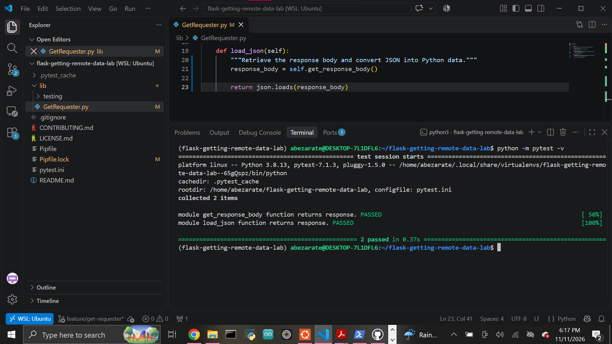

# Getting Remote Data Lab

A Python project that demonstrates how to retrieve remote data from an API using HTTP GET requests and convert JSON responses into Python data structures.

## Overview

This lab implements a reusable `GetRequester` class.

The class:

- stores a remote URL,
- sends an HTTP GET request,
- returns the raw response body,
- converts JSON response data into Python objects.

## Endpoint

The project uses the following remote JSON endpoint:

```text
https://learn-co-curriculum.github.io/json-site-example/endpoints/people.json
```

The endpoint returns information about several people and their occupations.

## GetRequester Class

The class is located in:

```text
lib/GetRequester.py
```

### Initialization

A `GetRequester` object is initialized with a URL:

```python
requester = GetRequester(
    "https://learn-co-curriculum.github.io/json-site-example/endpoints/people.json"
)
```

The URL is stored for later HTTP requests.

## get_response_body()

The `get_response_body()` method sends an HTTP GET request using the `requests` package.

```python
response = requests.get(self.url)
```

It returns:

```python
response.content
```

This means the raw HTTP response body is returned as bytes.

Example response:

```text
[
  {
    "name": "Daniel",
    "occupation": "LG Fridge Salesman"
  },
  ...
]
```

## load_json()

The `load_json()` method retrieves the raw response body and converts the JSON into Python data structures.

```python
response_body = self.get_response_body()
return json.loads(response_body)
```

The JSON array becomes a Python list containing dictionaries.

Example:

```python
[
    {
        "name": "Daniel",
        "occupation": "LG Fridge Salesman"
    },
    {
        "name": "Joe",
        "occupation": "WiFi Fixer"
    },
    {
        "name": "Avi",
        "occupation": "DJ"
    },
    {
        "name": "Howard",
        "occupation": "Mountain Legend"
    }
]
```

## Data Flow

```text
URL
 ↓
HTTP GET request
 ↓
response.content
 ↓
raw JSON bytes
 ↓
json.loads()
 ↓
Python list and dictionaries
```

## Project Structure

```text
flask-getting-remote-data-lab/
├── images/
│   └── tests-passing.png
├── lib/
│   ├── GetRequester.py
│   └── testing/
│       ├── conftest.py
│       └── get_requester_test.py
├── Pipfile
├── Pipfile.lock
├── pytest.ini
└── README.md
```

## Setup

Install the project dependencies:

```bash
pipenv install
```

Enter the virtual environment:

```bash
pipenv shell
```

The project uses:

```text
Python 3.8.13
```

## Dependencies

The project uses:

- `requests` for HTTP GET requests
- `json` from the Python standard library for JSON parsing
- `pytest` for automated testing

## Testing

Run the test suite with:

```bash
python -m pytest -v
```

Current result:

```text
2 passed
```

The tests verify that:

- `get_response_body()` returns the raw response body,
- `load_json()` converts the response into the expected Python objects.

## Completed Test Suite



## Key Concepts

This lab demonstrates the difference between:

```python
response.content
```

which returns the raw HTTP response body as bytes, and:

```python
json.loads(response_body)
```

which converts JSON data into native Python objects.

This pattern can be reused in applications that need to consume remote APIs.

## Author

Abraham Zarate